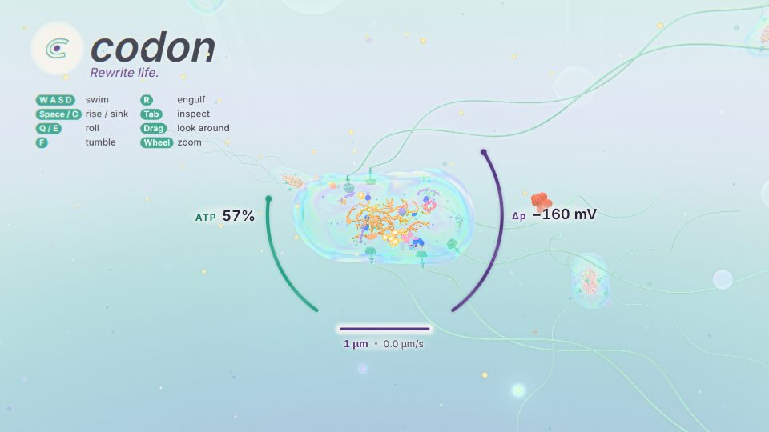
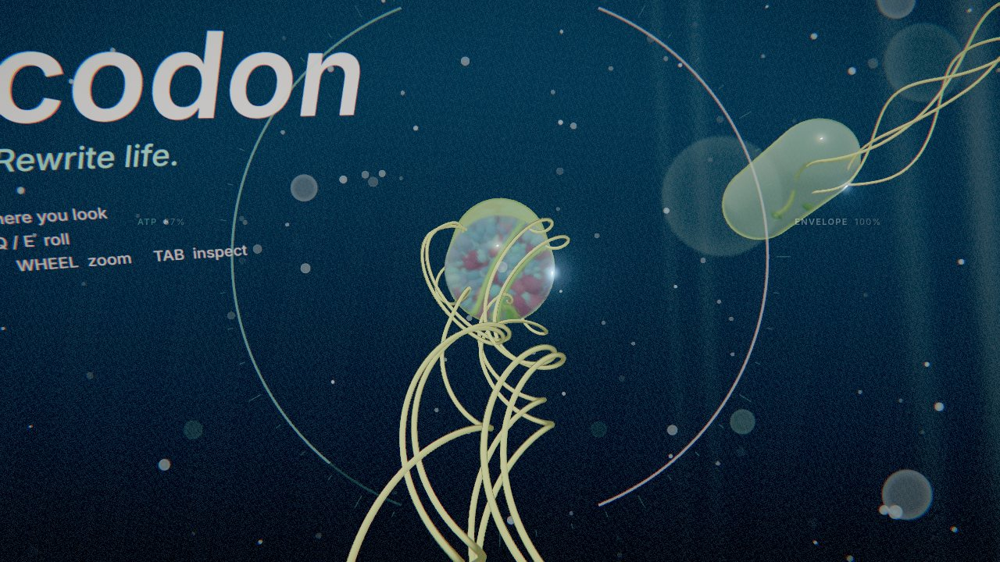
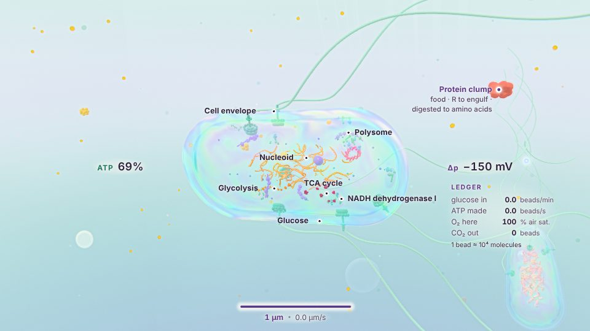
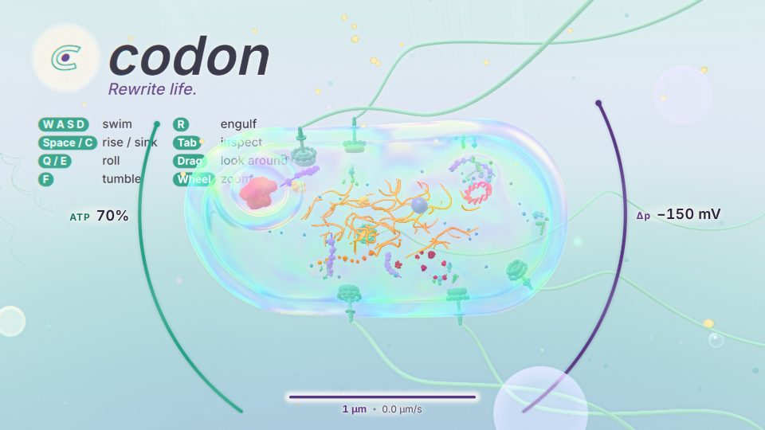
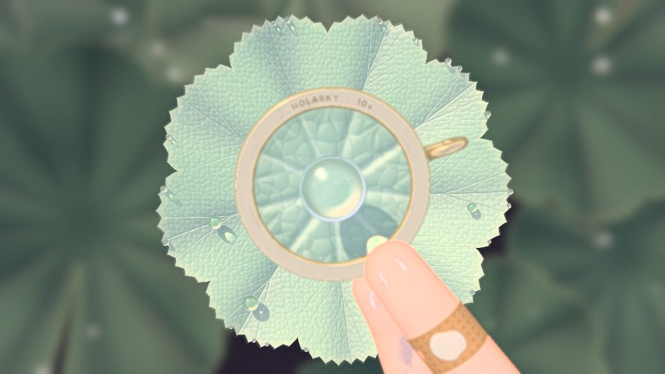
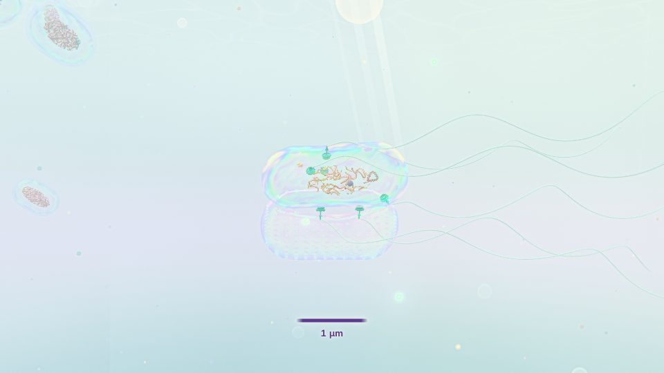
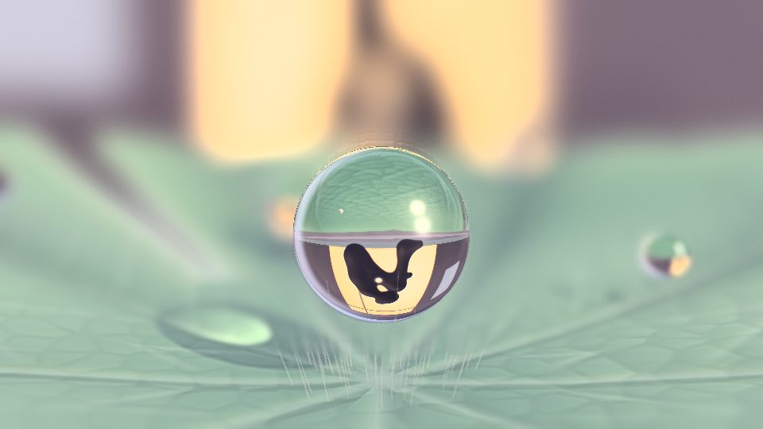
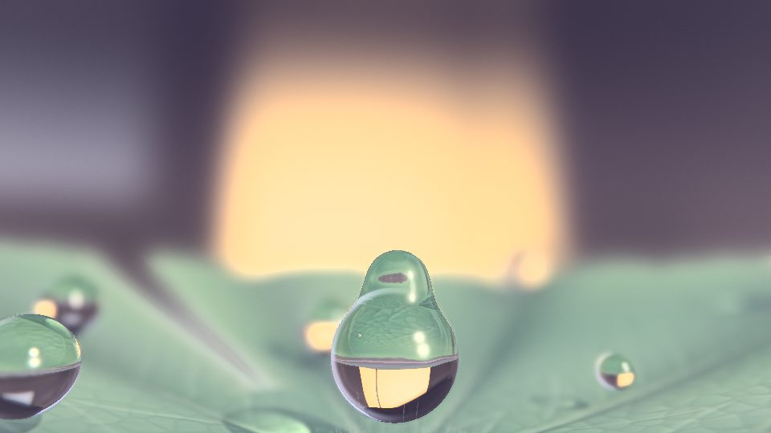

# Codon

A biology game about one bacterium and its genes, built with three.js. This is a prototype: the look, the feel of swimming, a faithful energy route, feeding by endocytosis and the opening are in; the gameplay loop is designed (`docs/design`) but not built yet.

You are a soft, wall-less bacterium (an E. coli L-form, 1 × 2 µm) in a dew drop on a leaf at dawn. Every cell in the drop, yours and its walled neighbours, is drawn as one volume by the same renderer and lit by the same light, so the membranes, the water and the insides belong to one world: translucent films that mirror the sky, a nucleoid you can follow strand by strand, and the energy route running through the cell as beads of light.

## Run it

```bash
npm install
npm run dev        # http://localhost:5173
npm test           # the energy route's bookkeeping, headless
```

`npm run build` writes a static site to `dist/`.

## The opening

On first launch the game opens in a garden at dawn (story: `docs/design/story.md` §5). A child holds a brass 10× loupe over the dew on a lady's mantle leaf; the cursor becomes the lens and the wheel focuses it with real thin-lens optics (past about 36 mm the image flips). Click, W or a trigger dives through the glass, down through the scales of the drop, to a rod that splits its wall and squeezes out soft: you. About 70 seconds, and the last frame is the game's first.

| Input | Does |
|---|---|
| Move the pointer | The loupe |
| Wheel | Focus |
| Click, W | Dive now (otherwise it dives by itself) |
| Hold Esc (or B on a gamepad) | Skip |
| C | Captions on or off |

It plays once (a flag in local storage; if storage is blocked it does not play), and keys pressed during it never reach the game. `?intro` plays it again, `?nointro` skips it. `?captions` shows captions for every sound, and reduced motion (the system setting, or `?reducedmotion`) replaces the camera moves with held, crossfaded frames.

"The first morning" (`src/morning.js`), the tear that made the hero, plays at the end of the first run once runs exist.

## Controls

| Key | Does |
|---|---|
| W A S D | Swim toward where you look |
| Space / C | Rise / sink |
| Q / E | Roll |
| F | Tumble: the flagella splay and the cell flips to a new heading |
| R | Engulf the food particle within reach |
| Drag, wheel | Look around, zoom |
| Tab | Inspect: slows time, moves in close, names the cell's parts and keeps a ledger of the energy route |

## What's modelled

- **Scale.** One unit is one micrometre. The bar under the cell is exactly 1 µm at the cell's depth.
- **Low Reynolds number.** At this size water behaves like syrup: no coasting, speed follows the motors almost at once, and the body counter-rotates against its flagella.
- **Run and tumble.** Running, the flagella bundle behind the cell; tumbling, they splay and the cell flips. Neighbouring rods do this on their own. The cocci can't swim and only drift.
- **The energy route, as E. coli runs it.** Glucose comes in through the PTS, runs down glycolysis, through pyruvate dehydrogenase and round the TCA cycle: 10 NADH, 2 QH2, 4 substrate-level ATP and 6 CO2 per glucose. Complex I and cytochrome bo3 pump 88 H+ into the periplasm per glucose; ATP synthase turns 36° per proton (a c10 ring) and makes ATP; the polysomes spend it. Below a quarter of air-saturated oxygen cytochrome bd takes over (64 H+); below 5% the cell ferments (formate, acetate and ethanol, 3 ATP per glucose) and runs its synthases backwards to hold the gradient. The ratios on screen are the real ones; the oxygen thresholds and the oxygen falling off with depth are staged (a real drop stays oxic much deeper), and one TCA step that really makes NADPH is counted as NADH.
- **Motors on Δp.** The flagellar motors run on the proton motive force, not ATP: swimming spends the gradient, food rebuilds it, and swim hard without food and it drains to a crawl in about 18 s. A wall-less cell's motors would have nothing to brace on; that the hero's work anyway is the game's one staged verb, and its tag says so.
- **Feeding.** Glucose drifts in patches and is taken in one molecule at a time. Food particles (protein, glycogen) are engulfed: the membrane folds into a round cup round the particle, its neck seals, the vesicle pinches off and digests the particle into monomers that join the route. E. coli can't do this; wall-less L-forms of Kitasatospora take up DNA and small particles this way (Kapteijn et al. 2022), and here it is a trait the hero has evolved.
- **Walls.** Ordinary E. coli carry a peptidoglycan wall, drawn as a calm satin layer that holds the cell still. The hero has none, which is why it flows. In the opening it squeezes out of its split wall; a real E. coli could not leave its wall behind and keep its outer membrane (that escape is filmed in Bacillus subtilis), so that moment is staged.

Anything staged is said so in the code where it happens, and gameplay.md plans an in-game "where we cheated" page.

## Performance

Every cell is ray-marched at full resolution. In play a governor watches the frame time: below about 45 fps it lowers the march's quality, then the resolution the cells are drawn at, and raises them again when frames are fast. The opening adapts on its own and compiles its shaders while the start screen waits for a click.

## The interface lives in the water

There is no screen-space HUD. Two arcs float beside the cell (ATP in mint, the proton motive force in plum), with the 1 µm bar and the swimming speed under it and a note above when the cell can't respire normally. In inspect mode names are pinned to the parts they name, with no leader lines; a legend says what each bead is and a ledger counts the route.

## Design

`docs/design` holds the research digest (45 peer games and what Codon takes from and avoids in each), the gameplay design (Phase 1 is the Codon Wheel: an evolution tree of 148 nodes covering the membrane, movement, energy, senses, organelles and more, with honesty badges saying what is real biology), and the story with the opening's shot list.

## Layout

| File | What |
|---|---|
| `src/main.js` | Renderer, camera, post-processing, the frame loop |
| `src/cellpass.js` | One ray-marched volume for every cell: films, periplasm, nucleoid, complexes, vesicles, walls |
| `src/bacterium.js` | The cells: the hero's sites and complexes, flagella, neighbours, cocci, the shed wall |
| `src/materials.js` | The flow warp every cell moves by, dents, the organic surface material |
| `src/water.js` | The drop: sky dome, caustics, particles with depth of field, light shafts |
| `src/lens.js` | The palette, tone mapping and the final lens grade |
| `src/player.js` | Input and swimming |
| `src/metabolism.js` | The energy route and its ledger |
| `src/feeding.js` | Glucose, oxygen, food particles and endocytosis |
| `src/neighbours.js` | Other microbes and how they move |
| `src/hud.js`, `src/style.css` | The in-world interface |
| `src/intro.js` | The opening's director: timeline, input, skip, captions |
| `src/garden.js` | The garden at dawn: the leaf, the dew, the loupe and its optics |
| `src/intro-micro.js`, `src/crowd.js` | The opening's descent into the drop and the birth of the hero |
| `src/morning.js` | The first morning |
| `src/audio.js` | The opening's procedural sound |
| `src/palette.js` | Colours for biology and for the interface |
| `test/metabolism.test.mjs` | `npm test`: the route's per-glucose bookkeeping in every mode |

## Debug switches

Add to the URL:

| Switch | Does |
|---|---|
| `?inspect` | Start in inspect mode |
| `?govern=N` | Start the quality governor at level N (0 full to 4 lowest), to see what a slow GPU gets |
| `?keys=KeyW,KeyA` | Hold keys from the start |
| `?frames=N` | Render N fixed steps and stop (screenshots on slow software renderers) |
| `?intro`, `?nointro` | Play or skip the opening |
| `?captions`, `?reducedmotion` | Captions; reduced motion |
| `?oxygen=x` | Hold the oxygen level at x (0..1) |
| `?feed=near&feedkind=protein` | A food particle (protein or glycogen) starts within reach; add `&keys=KeyR` to engulf it |
| `?feedskip=S` | Jump S seconds into an engulf |
| `?feedwarm=S` | Run the water and the route for S seconds before the first frame |
| `?feedcam=D`, `?feedview=x,y,z` | Start the camera D µm from the hero, from a direction in its body space |

## Deploying

The game runs on a Cloudflare Worker named `codon`, which serves `dist/` as static assets (`wrangler.jsonc`). `.github/workflows/deploy.yml` builds and deploys it on every push to the repository's default branch. Until the two secrets below exist, the workflow skips the deploy and says so in its log.

1. In the Cloudflare dashboard, open **My Profile → API Tokens → Create Token** and start from the **Edit Cloudflare Workers** template, limited to your account.
2. Copy your **Account ID** from the dashboard's Workers & Pages overview.
3. In GitHub, open **this repository → Settings → Secrets and variables → Actions → New repository secret** and add `CLOUDFLARE_API_TOKEN` and `CLOUDFLARE_ACCOUNT_ID`.
4. Run **Actions → Deploy Codon → Run workflow**, or push. The log ends with the address, `https://codon.<your-subdomain>.workers.dev`.

To deploy from your own machine instead: `npx wrangler login`, then `npm run deploy`.

## Screenshots

Rendered in headless Chromium with a software renderer at 960 × 540, so they are softer and grainier than on a GPU.

| Start | Swimming |
|---|---|
|  |  |
| **Inspect** | **Engulfing a protein particle** |
|  |  |
| **The opening: the loupe over the leaf** | **The opening: the soft one squeezes out** |
|  |  |
| **The first morning: the child in the drop** | **The first morning: the tear merges** |
|  |  |

The icon in `public/brand/` is the Holarky family letter c, copied from the holarky-account brand folder.
